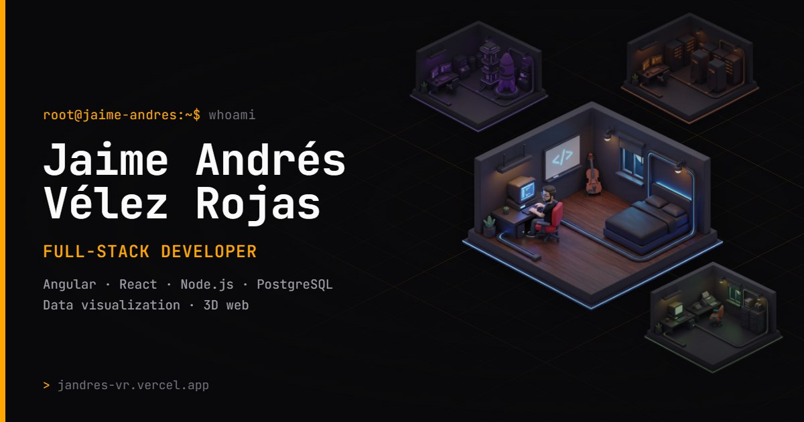
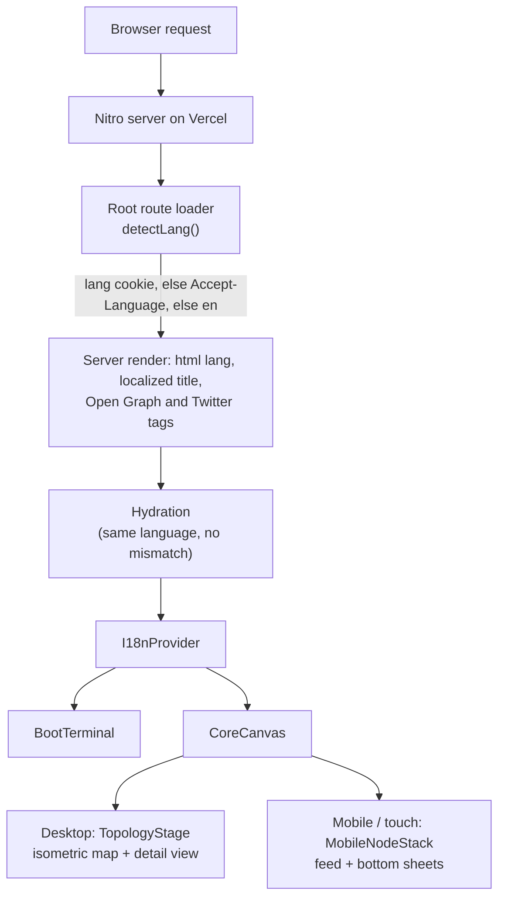
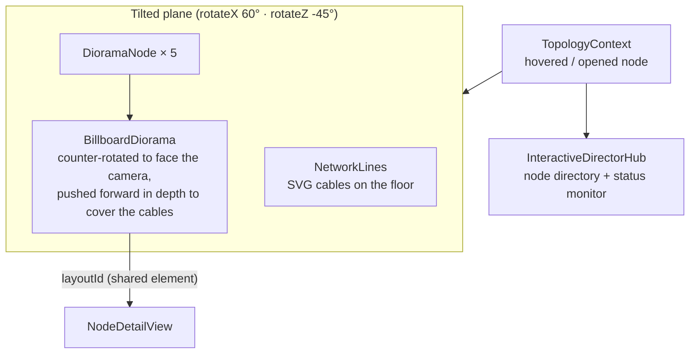
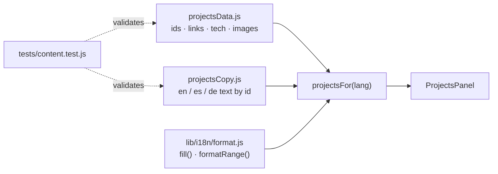

<div align="center">

# Jaime Vélez Rojas · Isometric Portfolio

**An explorable isometric map of my work, rendered on the server in your language.**

[](https://jandres-vr.vercel.app)
[](https://jandres-vr.vercel.app/cv/CV_Jaime_Andres_Velez_Rojas.pdf)
[](https://www.linkedin.com/in/jandresvr)


[](https://github.com/jandresvr92/web-portfolio/commits/main)
[](https://github.com/jandresvr92/web-portfolio/actions/workflows/ci.yml)
[](LICENSE)

<a href="https://jandres-vr.vercel.app">
  
</a>

</div>

---

## Table of contents

- [Highlights](#highlights)
- [Tech stack](#tech-stack)
- [Architecture](#architecture)
- [Project structure](#project-structure)
- [Content model: adding projects, jobs and more](#content-model-adding-projects-jobs-and-more)
- [Getting started](#getting-started)
- [Quality gates](#quality-gates)
- [Deployment](#deployment)
- [Performance and accessibility](#performance-and-accessibility)
- [Conventions](#conventions)
- [Roadmap](#roadmap)
- [Author](#author)
- [License](#license)

## Highlights

- **An isometric map instead of a page.** Five rooms (about me, projects, stack, experience and hobbies) stand on a tilted grid, linked by animated cables. Each room opens into a detail view through a shared-element transition.
- **Pure CSS 3D, no WebGL.** The floor, the billboarded rooms and the depth sorting are CSS transforms. The page stays light and works without a GPU-heavy canvas.
- **Server-rendered in the visitor's language.** English, Spanish or German is picked on the server from a cookie or the `Accept-Language` header, so the first frame (boot terminal included) is already translated and hydration always matches.
- **Two layouts, one content source.** Wide, mouse-driven screens get the map; phones and any touch-only device get a flat terminal-style feed with bottom sheets.
- **Content that validates itself.** Each node's data is described once and translated separately, and 22 tests check every language, file and layout limit before a change can ship.
- **Ready to share.** Localized `<title>` and meta tags, Open Graph and Twitter cards with a 1200×630 image, a canonical URL and a favicon set.

## Tech stack

| Layer | Technology | Why |
| --- | --- | --- |
| Framework | [TanStack Start](https://tanstack.com/start) + [TanStack Router](https://tanstack.com/router) | Server rendering and file-based routing with a small footprint |
| UI | React 19, plain JavaScript (JSX) | No TypeScript by design; content is validated by tests instead |
| Styling | Tailwind CSS 3 | Utility classes; every node accent is written out in full so the build keeps it |
| Motion | Framer Motion 11 | Shared-element transitions between the map and the detail view |
| Icons | Lucide | One consistent line-icon set |
| Server and build | Vite 8 + Nitro 3 | Nitro emits a Node server locally and Vercel output on Vercel |
| Testing | Vitest 5 | Content tests that run in Node, without a browser |
| Linting | ESLint 9 (flat config) + `react-hooks` | Rules of hooks enforced as errors |
| Hosting | Vercel | Preview deployment for every pull request |

## Architecture

### Request flow



1. **Language on the server.** The root route's loader calls `detectLang()`, an isomorphic function. On the server it reads the `lang` cookie (set only when the visitor uses the toggle) and falls back to `Accept-Language` with its `q` weights. The response varies on both headers, so a shared cache never serves one visitor's language to another.
2. **One document, no `index.html`.** `src/routes/__root.jsx` renders `<html>`, `<head>` and the meta tags. Each language has its own title, description, `og:locale` and image alt text.
3. **Boot, then canvas.** The boot terminal types its lines in the visitor's language, then fades out and reveals the canvas.
4. **Desktop or mobile by capability, not only width.** The map needs a wide screen and a pointer that can hover. Touch-only devices get the feed whatever their width.

### The map



- `topology/layout.js` holds the geometry: plane size, tilt, perspective, node coordinates and how each room's artwork is framed.
- Rooms are billboards: counter-rotated against the floor so they stand upright, and moved forward in depth so they paint over the cables that run behind them.
- Hovering a room darkens the others with a brightness filter rather than opacity, so they stay opaque and keep hiding those cables.
- `TopologyContext` shares the hovered and opened node between the map and the directory, so each highlights the other in both directions.

### Content pipeline



Every node follows the same pattern: structure once in `*Data.js`, text per language in `*Copy.js`, and a builder (`projectsFor`, `experienceFor`, `stackFor`, `hobbiesFor`) that merges them for the panel. Numbers shown on screen are computed from the data, never typed into the copy:

- the project count in the status line and the numbering of locked modules;
- years of experience, from the job dates (profile, bio and experience status line);
- job date ranges, from `"YYYY-MM"` values, with month names taken from the dictionaries so the server and the browser print the same text.

## Project structure

```text
.
├── public/
│   ├── cv/                     # downloadable CV (PDF)
│   ├── images/                 # room artwork, avatar, project screenshots, share image
│   └── favicon.svg · favicon.ico · apple-touch-icon.png
├── src/
│   ├── routes/
│   │   ├── __root.jsx          # the HTML document, language loader, meta tags
│   │   └── index.jsx           # the only page: boot terminal + canvas
│   ├── components/
│   │   ├── boot/               # boot terminal
│   │   ├── core/
│   │   │   ├── topology/       # desktop map: layout, rooms, cables, detail view
│   │   │   ├── director/       # node directory and status monitor
│   │   │   ├── mobile/         # mobile feed and bottom sheets
│   │   │   ├── profile/ projects/ stack/ experience/ hobbies/
│   │   │   │                   # each node: Panel.jsx + *Data.js + *Copy.js
│   │   │   └── nodeTheme.js    # per-node accent palettes
│   │   └── NotFound.jsx · DefaultCatchBoundary.jsx · TerminalScreen.jsx
│   ├── lib/
│   │   ├── i18n/               # dictionaries, provider, detection, formatting
│   │   ├── site.js             # production URL and share image
│   │   └── TopologyContext.jsx
│   └── index.css
├── tests/content.test.js       # content validation (Vitest)
├── tools/                      # sources and build script for the CV PDF and the share image
├── .github/workflows/ci.yml    # lint + tests + build on every pull request
├── AGENTS.md                   # rules for anyone, human or AI, changing the code
└── vite.config.js · vitest.config.js · tailwind.config.js · eslint.config.js
```

## Content model: adding projects, jobs and more

Each `*Data.js` file starts with a comment that explains how to add an entry. In short:

| To add | Edit | Then |
| --- | --- | --- |
| A project | Append it to `PROJECTS` in `projects/projectsData.js`, add its `title` and `desc` under the same id in all three languages of `projectsCopy.js`, and put a 1280×720 `.webp` screenshot in `public/images/projects/` | The project count and the locked module numbers update on their own |
| A job | Add it to `JOBS` in `experience/experienceData.js`, newest first, with `start`/`end` as `"YYYY-MM"` (`end: null` for a current job), plus its `role` and `achievements` in `experienceCopy.js` | Years of experience and the date labels update on their own |
| A technology | Replace or merge a blade in `stack/stackData.js` (the rack holds exactly four per tab) and describe it in `stackCopy.js` | |
| A hobby | Swap one of the six items in `hobbies/hobbiesData.js` and its text in `hobbiesCopy.js` | |

Then run `npm test`. If something is missing or does not fit, the failing test says what and where, for example *"the inventory is a 6-slot grid; swap a hobby out to add one"*.

**Layout limits enforced by the tests**

| Node | Limit |
| --- | --- |
| Projects | 1–6 uppercase tech tags of up to 14 characters; title up to 24 characters; description up to 100 |
| Experience | 1–3 achievements of up to 120 characters; role up to 32 |
| Tech stack | exactly 4 blades per tab; name up to 24 characters; description up to 90 |
| Hobbies | exactly 6 items; name up to 24 characters; buff up to 44; description up to 180 |

### Translations

- Shared strings (nodes, boot lines, meta tags, month names, error screens) live in `src/lib/i18n/dictionaries.js`; node text lives in each `*Copy.js`.
- Every language must have the same keys and ids; the tests compare them.
- Templates use `{placeholders}` (`{count}`, `{years}`, `{n}`) filled by `fill()`. A placeholder left unfilled fails the tests instead of reaching the screen.

## Getting started

**Requirements:** Node.js 22 LTS (tested with 22.14) and npm.

```bash
git clone https://github.com/jandresvr92/web-portfolio.git
cd web-portfolio
npm ci
npm run dev        # http://localhost:5173
```

| Script | What it does |
| --- | --- |
| `npm run dev` | Development server with hot reload |
| `npm run build` | Production build with Nitro (`.output/`, a Node server) |
| `npm run preview` | Serves the production build locally |
| `npm run lint` / `npm run lint:fix` | ESLint |
| `npm test` | Content tests (Vitest) |
| `npm run check` | Lint + tests + build: run it before every pull request |
| `npm run cv:build` | Regenerates the CV PDF from `tools/cv/cv.html` |
| `npm run og:build` | Regenerates the 1200×630 share image from `tools/og/og.html` |

## Quality gates

`npm run check` must pass before a change is merged. It runs:

1. **ESLint** with the recommended rules and `react-hooks/rules-of-hooks` as an error.
2. **Content tests** (`tests/content.test.js`, 22 tests), which check that:
   - every language has the same keys and ids, the dictionaries included;
   - every file referenced in the data (screenshots, room artwork, CV, avatar, icons, share image) exists in `public/`;
   - links use `https`, dates are valid and jobs run newest first, icons and accent colors exist in the code, and ids are unique kebab-case;
   - the layout limits above hold;
   - no rendered text is empty or keeps an unfilled `{placeholder}`.
3. **A production build.**

[GitHub Actions](.github/workflows/ci.yml) runs the same three steps on every pull request and every push to `main`, so a change that breaks them shows a red check before it can be merged, whoever wrote it. Every pull request also gets a Vercel preview deployment to check the result in the browser on desktop and at mobile width.

## Deployment

The site is deployed on [Vercel](https://vercel.com). Nitro detects Vercel during the build and writes `.vercel/output/`, so there is no `vercel.json` and no custom build command or output directory.

```bash
NITRO_PRESET=vercel npm run build   # reproduce the Vercel output locally
```

- **Production URL.** `src/lib/site.js` holds the public origin used for `og:image`, `og:url` and the canonical link, which must be absolute. Update it if the domain changes.
- **Static files** go in `public/images/` or `public/cv/`, never in `public/assets/`: that path holds Vite's hashed bundles and is cached for a year.
- **Social previews are cached** by LinkedIn and WhatsApp. After changing the share image or the title, refresh LinkedIn with its [Post Inspector](https://www.linkedin.com/post-inspector/), or share a URL with a query string such as `?ref=wa`.

## Performance and accessibility

- **Light assets.** Room artwork, the avatar and project screenshots are WebP (about 40 KB per room); project screenshots load lazily.
- **No WebGL.** The 3D effect is CSS transforms on a single tilted plane.
- **Server-rendered first frame.** Language, title and meta tags arrive in the HTML; nothing switches language after the page loads.
- **Reduced motion.** With `prefers-reduced-motion`, the ambient loops (cables, pulses, LEDs, the boot caret) stop and show a still, readable state.
- **Keyboard and screen readers.** Rooms are real, labelled buttons that light up on keyboard focus just as on hover; decorative images have empty `alt`; and `<html lang>` follows the active language.
- **Dark by default.** `color-scheme: dark` and a dark body background, so overscroll and the error pages never flash white.
- **Supply-chain cooldown.** `.npmrc` sets `min-release-age=7`, so npm never installs a version published less than a week ago.

## Conventions

The full rules live in [`AGENTS.md`](AGENTS.md): workflow, code conventions, content rules, how to regenerate the CV and share image, and the design rules (palette, typography, shapes, motion, accessibility). Many coding agents (Codex, Cursor, GitHub Copilot) read it on their own and `CLAUDE.md` points Claude to it; with any other tool, ask it to read `AGENTS.md` first. The essentials:

- JavaScript and JSX only; never edit or commit the generated `src/routeTree.gen.ts`.
- Import with the `@/` alias (`@/lib/utils` → `src/lib/utils`).
- The server and the first client render must match: read `window`, `document` and storage only in effects or handlers.
- Every visible string exists in English, Spanish and German.
- Counts and years come from the data, never from the copy.
- `vite.config.js` keeps the plugin order `tanstackStart()`, `nitro()`, `react()`; `nitro` stays pinned to an exact release until v3 is stable.

## Roadmap

- [x] Server-side language detection and localized meta tags
- [x] Share card, canonical URL and favicon set
- [x] Data/copy split with content tests
- [x] GitHub Actions running lint, tests and build on every pull request
- [x] Written design rules (palette, type scale, motion) and the CV and share-image sources in the repository
- [ ] Optional visual regression tests with Playwright
- [ ] A full-stack project (Node.js + PostgreSQL API with its own frontend) in the projects node

## Author

**Jaime Andrés Vélez Rojas**, full-stack developer (Angular, React, Node.js, PostgreSQL), Medellín, Colombia.

[Portfolio](https://jandres-vr.vercel.app) · [LinkedIn](https://www.linkedin.com/in/jandresvr) · [CV](https://jandres-vr.vercel.app/cv/CV_Jaime_Andres_Velez_Rojas.pdf)

## License

The **source code** is released under the [MIT License](LICENSE): you are free to read it, learn from it and reuse it.

The **personal content and artwork** are not covered by that license and remain © Jaime Andrés Vélez Rojas, all rights reserved:

- the room illustrations, avatar, project screenshots and share image in `public/images/`;
- the CV in `public/cv/`;
- the site icons (`favicon.svg`, `favicon.ico`, `apple-touch-icon.png`);
- the biographical text, job history and project descriptions.

If you build on this code, replace them with your own.
